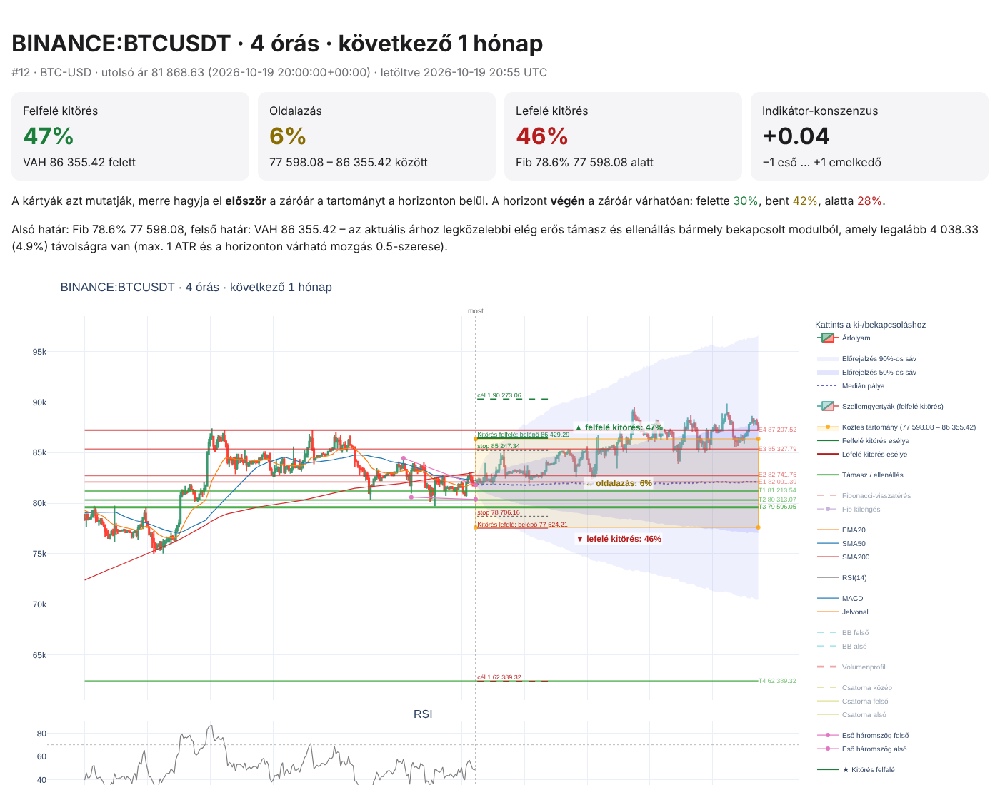

# Chartelemző

Egy TradingView-képernyőképből (vagy egy megadott szimbólumból) technikai elemzést
készít a választott idősíkhoz tartozó előrejelzési horizontra. Az eredmény egy
interaktív HTML-chart a következőkkel:

- **támasz- és ellenállásszintek**, mindegyik indoklással: miért éppen ott, és miért ennél az eszköznél;
- egy **köztes tartomány**, és annak esélye, hogy az ár **felfelé kitör, lefelé kitör vagy oldalaz**;
- **szellemgyertyák**, vagyis a legvalószínűbb forgatókönyv egy jellemző szimulált pályája, köré rajzolt 50%-os és 90%-os sávval;
- **belépési pontok** (belépő, stop, célár) mindhárom forgatókönyvhöz;
- **magyar nyelvű elemzés** forrásmegjelöléssel (Claude, webes keresés);
- **napló**: minden elemzés és elképzelés elmentve, később visszakereshető, ellenőrizhető és finomítható.



## Idősíkok és horizontok

| Chart idősík | Előrejelzés |
|---|---|
| heti (`1w`) | következő 1 év |
| napos (`1d`) | következő 3 hónap |
| 4 órás (`4h`) | következő 1 hónap |
| órás (`1h`) | következő 2 hét |
| negyedórás (`15m`) | következő kereskedési nap |
| 5 perces (`5m`) | következő 8 óra (nyitott piacon) |

Piacok: részvények (amerikai, BÉT, európai stb.), kripto, deviza, nyersanyagok és indexek.
Az árfolyamadat mindig frissen jön a Yahoo Finance-ről.

## Telepítés

```bash
python -m venv .venv && source .venv/bin/activate
pip install -e '.[dev]'
export ANTHROPIC_API_KEY=...   # Claude: kép kiolvasása + magyar elemzés
```

API-kulcs nélkül is működik (`--ai-nelkul`). Ilyenkor a szimbólumot és az idősíkot meg
kell adni, és a szöveges összefoglalót a program a számításokból rakja össze.

## Használat

```bash
# Új elemzés képből (a szimbólumot és az idősíkot Claude olvassa le a képről)
chartelemzo elemez kep.png --otlet "Szerintem a 200-as szint fölé megy nyárig" --megnyit

# Kép nélkül vagy felülírva
chartelemzo elemez --szimbolum BET:OTP --idosik 1d
chartelemzo elemez kep.png --idosik 4h --tartomany 180:195   # kézi köztes tartomány

# Indikátorok ki- és bekapcsolása
chartelemzo indikatorok
chartelemzo elemez kep.png --ki elliott,fibonacci

# Napló, ellenőrzés, finomítás
chartelemzo naplo [--szimbolum OTP] [--keres "nyárig"]
chartelemzo mutat 12 --megnyit
chartelemzo ellenoriz 12            # bejött-e? (friss adattal)
chartelemzo finomit 12 --otlet "Jött egy erős gyorsjelentés" [--kep uj.png]
```

A kimenet az `adatok/` mappába kerül: a napló `adatok/naplo.db`, minden elemzés a saját
mappájába (`jelentes.html`, `elemzes.md`, a beküldött kép). Ez a hely a
`CHARTELEMZO_ADAT` környezeti változóval módosítható.

## Beállítások

Az alapértékek a `chartelemzo/beallitasok.toml` fájlban vannak. Felülírásukhoz tegyél egy
`beallitasok.toml` fájlt a munkakönyvtárba. Ezekben állítható:

- `[indikatorok] alapbol`: mely modulok futnak alapból;
- `[abra] lathato`: mely modulok látszanak alapból a charton (a többit a jelmagyarázatra kattintva lehet bekapcsolni);
- `[elorejelzes] irany_sulyozas`: a szimuláció sodródjon-e enyhén az indikátorok irányába;
- `[ai] webes_kereses`: Claude keressen-e híreket és fundamentumokat.

A modell a `CHARTELEMZO_MODELL` környezeti változóval cserélhető (alapból `claude-opus-5-5`).
A Claude-hívásokban be van kapcsolva a szerveroldali tartalékmodell (`fallbacks: "default"`):
ha a biztonsági szűrő elutasít egy kérést, a szerver automatikusan egy ajánlott tartalékmodellel futtatja újra.

Az architektúra és a további tervek leírása: [docs/TERVEZET.md](docs/TERVEZET.md).

> Ez egy automatizált elemzőeszköz, nem befektetési tanácsadás.
